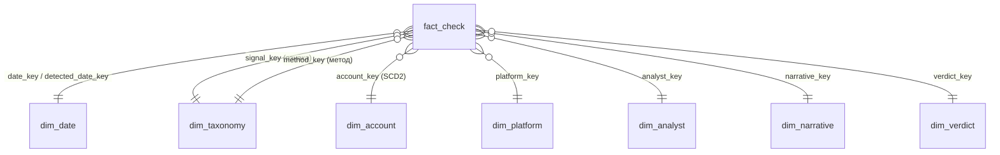

# ЛР12 · Проєкт зіркової схеми «Перевірка публікацій»

Domain Knowledge Hub, тематична область «Аналіз достовірності інформації».

## 1. Бізнес-процес і зерно

**Бізнес-процес** — перевірка підозрілих публікацій фактчекерами. Публікацію виявляють за ознакою дезінформації, аналітик застосовує метод перевірки, збирає докази і виносить вердикт.

**Зерно факту** — *один рядок = одна завершена перевірка однієї публікації одним фактчекером*. Рядок датується днем винесення вердикту.

Зерно визначено першим, тому що від нього залежить, які виміри можна приєднати і які міри мають сенс. На цьому зерні:
- кожна перевірка має рівно одну головну ознаку, один основний метод, один вердикт, одного автора й одного аналітика;
- міри «кількість перевірок», «охоплення», «доказів» коректно додаються за будь-якими вимірами.

Дрібніше зерно «одна ознака в публікації» дало б кілька рядків на одну перевірку. Тоді сума охоплення подвоювалась би.

## 2. Бізнес-питання

| № | Питання | Виміри / міри |
|---|---|---|
| BQ1 | Які класи й підкласи ознак дезінформації (таксономія) найчастіше приводять до вердикту «фейк» або «маніпуляція»? | dim_taxonomy (ознака) → частка хибних |
| BQ2 | Скільки часу триває перевірка залежно від методу й пріоритету, і чи виконується SLA регламенту v2.0 (високий пріоритет — 12 год)? | dim_taxonomy (метод), priority → AVG годин, частка SLA |
| BQ3 | Які платформи і типи акаунтів дають найбільше охоплення спростованих публікацій? | dim_platform, dim_account → SUM shares |
| BQ4 | Як навантаження розподілене між організаціями й аналітиками за тижнями? | dim_analyst, dim_date → COUNT, backlog |
| BQ5 | Які наративи зростають: накопичена кількість фейків і 7-денне ковзне середнє? | dim_narrative, dim_date → вікна |
| BQ6 | Чи вища частка фейків в акаунтів із нижчою довірою (на момент перевірки)? | dim_account (SCD2) → частка хибних |

## 3. Виміри

| Вимір | Зміст | Ієрархія | SCD |
|---|---|---|---|
| dim_date (роль: дата вердикту, дата виявлення) | календар 01.06–31.12.2026 | рік → квартал → місяць → тиждень → день | — (статичний) |
| **dim_taxonomy** (ролі: ознака, метод) | поняття SKOS з `taxonomy/taxonomy.ttl`, **кожне з IRI** `http://www.lnu.edu.ua/ontologies/disinfo-analysis.owl#…` | гілка (рівень 1) → клас (рівень 2) → поняття (рівень 3) | тип 1 для назв; зміна змісту поняття = новий IRI |
| dim_account | автор публікації | тип акаунта → акаунт; рівень довіри | **тип 2** за `trust_level` (valid_from / valid_to / is_current) |
| dim_platform | платформа | тип платформи → платформа | тип 1 |
| dim_analyst | фактчекер | організація → аналітик | тип 1 |
| dim_narrative | наратив (0 = «без наративу») | тема → наратив | тип 1 |
| dim_verdict | категорія вердикту | хибний (фейк/маніпуляція) / ні → категорія | статичний |

Вироджені виміри (у факті): `check_id`, `publication_id`, `priority`.

### Таксономія як вимір

Таксономію ЛР 4–5 записано у SKOS (`etl/taxonomy.py` → `taxonomy/taxonomy.ttl`, 28 понять, 146 трійок). ELT читає її через rdflib і розгортає ієрархію `skos:broader` у плоскі колонки: `branch_*` (рівень 1) і `class_*` (рівень 2). Тому drill-down «клас → підклас → поняття» — це звичайний GROUP BY.

Вимір має дві ролі:
- `signal_key` — ознака, гілка S «Ознаки дезінформації»;
- `method_key` — метод, гілка M «Методи перевірки».

IRI поняття збігається з простором імен онтології СР 6. Отже, рядок куба можна пов'язати з онтологією і графом знань.

| Нотація | Поняття (рівень 2 → 3) |
|---|---|
| S1 За змістом | S1.1 Емоційна лексика; S1.2 Немає першоджерела; S1.3 Вирваний контекст; S1.4 Терміновий збір коштів |
| S2 За автором | S2.1 Новий неверифікований акаунт; S2.2 Масові репости бот-мережі; S2.3 Зміна тематики; S2.4 Спростовані дописи |
| S3 За медіа | S3.1 Застаріле фото (EXIF); S3.2 Невідповідність геолокації; S3.3 Дипфейк або монтаж |
| M1 Технічна верифікація | M1.1 Реверсивний пошук; M1.2 Аналіз EXIF; M1.3 Геолокація; M1.4 Аналіз мережі поширення |
| M2 Звірка з базами | M2.1 Бази фактчекерів; M2.2 Офіційне джерело |
| M3 Експертна перевірка | M3.1 Пошук першоджерела; M3.2 Перехресна перевірка; M3.3 Запит до експерта |

### Політика SCD

- **dim_account — тип 2.** Правило R2 знижує індекс довіри автора після спростування. Аналіз «чи впливає довіра на частку фейків» має брати довіру *на момент перевірки*, а не поточну. Тому кожна зміна дає нову версію з сурогатним ключем. Факт посилається на версію, чинну на дату вердикту: `verdict_date BETWEEN valid_from AND valid_to`. У наборі 120 акаунтів мають 145 версій, і 193 факти посилаються на вже неактуальні версії.
- **Інші виміри — тип 1.** Виправлення назв і перехід аналітика до іншої організації перезаписуються, бо для питань BQ1–BQ6 історія цих атрибутів не потрібна.

## 4. Міри

| Міра | Тип | Як агрегувати |
|---|---|---|
| check_count | адитивна | SUM за всіма вимірами |
| shares_at_check (охоплення на момент перевірки) | адитивна | SUM |
| evidence_count | адитивна | SUM; середнє — похідна |
| effort_minutes (трудовитрати аналітика) | адитивна | SUM |
| backlog_open (відкриті справи аналітика на момент вердикту) | **напівадитивна** | SUM між аналітиками на один момент; за часом — лише AVG/MAX/останнє значення |
| hours_to_verdict | **неадитивна** | AVG, медіана, перцентилі; сума не має змісту |
| confidence (0–1) | **неадитивна** | AVG, мінімум |
| sla_met | **неадитивна** (прапорець) | частка = SUM(sla_met)/COUNT |
| Похідні: частка хибних вердиктів, частка SLA | неадитивні (відношення) | обчислюються з адитивних чисельника/знаменника, не усереднюються |

## 5. Схема

DDL: `sql/ddl.sql`. Діаграма: `docs/img/star.png`. Mermaid-версія:

Цілісність гарантують обмеження PRIMARY KEY / FOREIGN KEY / CHECK у DDL і перевірки DQ1–DQ8 (`results/dq_report.md`).

## 6. Дані

Дані синтетичні: `etl/generate.py`, seed = 12. Генератор документовано в заголовку файла.

Базою слугують сутності графа знань ЛР 9:
- 45 акаунтів;
- 6 фактчекерів;
- 4 організації;
- 6 наративів.

До них генератор додає 75 акаунтів і 6 аналітиків. Подій перевірки 2138 за 01.07–31.10.2026, разом зі сплесками трьох наративів. Залежності між атрибутами задано явно:
- ознака й довіра → ймовірність фейку;
- метод і пріоритет → тривалість;
- спеціалізація аналітика → призначення.

Реальні персональні дані не використовуються.
