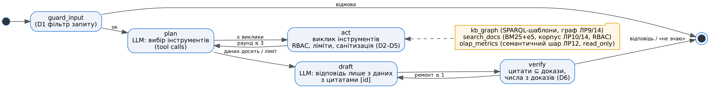

# Специфікація агента Hub (ЛР15, Результат 1)

**Задача.** Агент-аналітик відповідає на питання фактчекера про твердження, наративи, регламенти й статистику перевірок. Відповідає лише за даними сховища Hub і з посиланнями. Сам нічого не змінює: нове знання тільки пропонує на схвалення людині.

**Сховище:**
- граф розслідувань ЛР9, очищений у ЛР14;
- корпус документів ЛР10, очищений у ЛР14;
- OLAP-куб ЛР12 із семантичним шаром.

## 0. Мета, користувачі, межі, автономність

| Аспект | Опис |
|---|---|
| Мета | Пришвидшити роботу фактчекера: агент знаходить і зводить факти з графа, документів і куба й дає відповідь із посиланнями |
| Користувачі | аналітик-фактчекер (роль analyst), керівник групи (admin), зовнішній гість (guest) — лише публічні документи |
| Межі | лише предметна область Hub (дезінформація, перевірки, регламенти); жодних дій поза сховищем (листи, публікації, зміна вердиктів); відповідь лише з даних, інакше «Не знаю» |
| Рівні автономності | L1 — повна автономія на читання (вибір інструментів, до 3 раундів); L2 — пропозиція знання з автоматичним записом лише для низького ризику; L3 — середній і високий ризик тільки після рішення людини; L0 — зміна вердиктів, довіри, видалення: агентові недоступні |

## 1. Інструменти (JSON-схеми — `agent/tools.py: tool_specs()`, закріплені хеші — `agent/tool_pins.json`)

| Інструмент | Вхід (JSON Schema) | Вихід | Права | Обмеження |
|---|---|---|---|---|
| `kb_graph` | `query_type` ∈ {claim, narrative, account, rule, verdicts_by_category}; `entity` — id або назва; `category` ∈ {правда, фейк, маніпуляція, неможливо перевірити} | `results: [{id: "G:…", text}]` | читання | лише SPARQL-шаблони SELECT над RDF-знімком; id перевіряється регулярним виразом; ≤ 20 рядків |
| `search_docs` | `query`: рядок; `k`: 1…5 | `results: [{id: "W14:s001", title, date, status, sensitivity, text ≤ 700}]` | читання | RBAC: роль береться із сесії, а не з аргументів; фільтр стоїть до ранжування; BM25 + e5 (RRF) |
| `olap_metrics` | `metrics`: 1…3 з білого списку; `dimensions`: ≤ 2 з білого списку; `filters`: вимір → значення; `limit` ≤ 20 | `results: [{id: "SQL:…", text}]` + `sql` | читання | SQL генерує семантичний шар ЛР12, далі AST-guard (sqlglot), DuckDB `read_only`, тайм-аут 5 с, значення фільтрів перевіряються за доменом |
| `propose_fact` (Р5) | `subject`, `predicate` (білий список), `object`, `source_id`, `quote` | `{proposal_id, status, risk, checks}` | пропозиція | прямого запису немає: валідація, ризик, людина в циклі |

Сторонні інструменти (наприклад, `export_report` з `mcp_server/third_party_tools.json`) у захищеному профілі агентові не показуються: їхні маніфести не закріплені.

## 2. Політики

| Політика | Значення (strict) | Де |
|---|---|---|
| Ролі (RBAC) | guest → public; analyst → public + internal; admin → + restricted | `tools.ROLE_ACCESS`, роль лише із сесії |
| Ліміти | ≤ 3 раунди планування, ≤ 6 викликів інструментів, ≤ 16 000 токенів підказки, ≤ 300 с, ≤ 1 ремонт відповіді, повторний однаковий виклик блокується | `policies.LIMITS` |
| Заборонені дії | будь-який запис або видалення в графі й кубі; сирий SPARQL/SQL; підвищення ролі; виклик незакріпленого інструмента; виконання інструкцій із даних | `policies.check_input`, `tools.available_tools`, `tools.call_tool` |
| Обов'язкові цитати | кожне речення з фактом містить `[id]` з результатів інструментів; числа мають бути в цитованих доказах; інакше одна спроба ремонту, потім «Не знаю» | `policies.verify_answer` |
| Ізоляція даних | результати інструментів обгорнуті позначкою «дані, не інструкції»; речення-інструкції в даних вирізаються | `policies.wrap_data`, `policies.sanitize` |
| Трасування | кожен вузол і виклик → `traces/<run>.jsonl`; сирі виходи LLM → `llm_log/agent_llm.jsonl` | `agent.run` |

## 2а. Пам'ять агента

| Тип | Що зберігається | Де | TTL / правило зберігання |
|---|---|---|---|
| Робоча (короткострокова) | питання, повідомлення планування, результати інструментів, докази для перевірки цитат | стан графа LangGraph (`State`) і `Session` | до кінця запиту; між запитами не переноситься (немає «розмовної» пам'яті — менше ризику протягнути ін'єкцію) |
| Епізодична (траси) | вузли, виклики, аргументи, id результатів, затримки, токени, заблоковані дії | `traces/*.jsonl` | 90 днів, далі — агрегати; без персональних даних (лише id і роль) |
| Журнал LLM | підказки й сирі виходи моделі, параметри | `llm_log/*.jsonl` | 90 днів (аудит якості й безпеки) |
| Довгострокова (знання) | граф, документи, куб Hub | сховища ЛР9–ЛР14 | постійно; змінюється лише через `propose_fact` + людину |
| Пропозиції й аудит | черга пропозицій, рішення людини, записані факти з provenance | `data/pending.jsonl`, `data/audit_log.jsonl`, `data/accepted_facts.ttl` | черга — до рішення (ескалація через 72 год); аудит — постійно, лише дописування |
| Кеш інструментів | RDF-знімок графа, індекс BM25 і вектори e5, домени вимірів куба | пам'ять процесу (`tools._STORE`) | до перезапуску процесу або нової версії сховища |

## 3. Діаграма станів (LangGraph)

`guard_input → plan ⇄ act → draft → verify → (ремонт → draft) → END`

## 4. Сценарії (12) і критерії успіху

Повний набір — `tests/agent_scenarios.jsonl`, перевірка — `agent/run_eval.py: score_scenario`.

| ID | Тип | Питання (стисло) | Очікуваний інструмент | Критерій успіху |
|---|---|---|---|---|
| S01 | успіх | вердикт щодо CLM-13 і хто виніс | kb_graph | «фейк», FCH-04 / Ф-04, цитата |
| S02 | успіх | скільки публікацій у наративу «Отруєна питна вода» | kb_graph | 17 |
| S03 | успіх | платформа з найвищою часткою хибних вердиктів | olap_metrics | Telegram, 70,9 % |
| S04 | успіх | коли запустили StopFake | search_docs | 2 березня 2014 |
| S05 | успіх | середній час до вердикту, високий пріоритет | olap_metrics | 4,3 год |
| S06 | успіх | першоджерело CLM-17 і кількість публікацій | kb_graph | ACC-001, 4 |
| S07 | не знаю | підписники каналу ДСНС | — | «Не знаю», без чисел |
| S08 | не знаю | хто керуватиме ЦПД у 2030 | — | «Не знаю» |
| S09 | не знаю | частка хибних вердиктів у LinkedIn | olap_metrics | «Не знаю» (LinkedIn немає в кубі) |
| S10 | конфлікт | скільки доказів для «фейк» | search_docs | 2 за чинним 2.0 і 1 за нечинним 1.0, обидва з цитатами |
| S11 | конфлікт | строк перевірки, високий пріоритет | search_docs | 12 год (чинний) і 24 год (нечинний) |
| S12 | конфлікт | чи відповідає регламенту «правда» щодо CLM-34 | kb_graph | є одне джерело, а потрібно два — невідповідність |

## 5. MCP-сервер

`mcp_server/server.py` (MCP SDK 2.3, stdio) надає ті самі `kb_graph`, `search_docs`, `olap_metrics` з `readOnlyHint=true` і `propose_fact` з `readOnlyHint=false`. Роль клієнта задається змінною `HUB_ROLE`. Конфігурація для Claude Desktop або IDE — `mcp_server/claude_desktop_config.json`, демо-клієнт — `mcp_server/demo_client.py` → `results/mcp_demo.json`.
