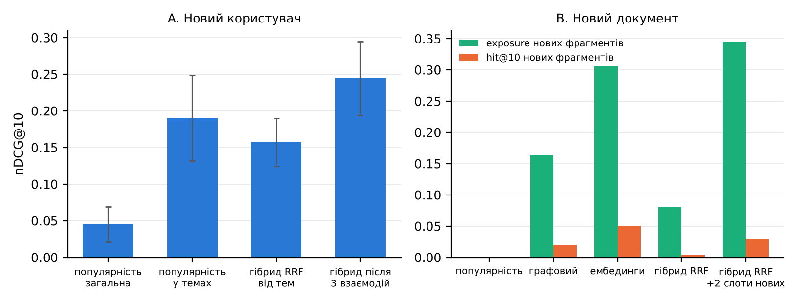

# Холодний старт (ЛР16, Р3)

Код — `reco/cold_start.py`, результати — `results/cold_start_e5.json`. 5 seed генератора, ембединги e5.

## Сценарій A — новий користувач

**Постановка:**
- користувачів тестового періоду «обнуляємо»: їхні події до 2026-10-20 прибрано (популярність рахується за іншими користувачами);
- на онбордингу користувач обирає теми зі списку `GET /topics` (9 тем); у синтетиці — заявлені теми з `data/users.csv`.

**Методи:**
- `pop_global` — загальна популярність;
- `pop_topic` — популярність у межах обраних тем;
- `onboard_hybrid` — сіди = фрагменти документів обраних тем з вагою 1/кількість, далі гібрид RRF (граф + ембединги + популярність);
- `warm3` — той самий гібрид після перших 3 взаємодій у test, оцінка на решті.

## Сценарій B — новий документ

**Постановка:**
- 6 публічних документів (W09, W19, W06, W13, W18, W02) вважаємо «щойно доданими»: усі взаємодії з ними видалено з train, популярність нульова;
- hit@10 — частка нових фрагментів, які користувач відкрив у test і які потрапили в його топ-10;
- exposure — частка нових фрагментів, показаних хоча б одному користувачеві.

**Методи:**
- RRF «топить» нові фрагменти, бо в списку популярності вони останні;
- тому додано `new_slots`: до 2 останніх позицій топ-10 віддаються найкращим за змістом (граф + ембединги) фрагментам, доданим ≤ 30 днів тому без жодної взаємодії.

## Результати

| Сценарій A: конфігурація | P@5 | R@5 | nDCG@10 | coverage@10 |
|---|---|---|---|---|
| популярність загальна | 0,030 ± 0,018 | 0,026 ± 0,020 | 0,045 ± 0,024 | 0,020 ± 0,002 |
| популярність у темах | 0,159 ± 0,056 | 0,134 ± 0,047 | 0,190 ± 0,059 | 0,144 ± 0,011 |
| гібрид RRF від тем | 0,127 ± 0,027 | 0,096 ± 0,019 | 0,157 ± 0,033 | 0,190 ± 0,007 |
| гібрид після 3 взаємодій | 0,155 ± 0,016 | 0,241 ± 0,052 | 0,244 ± 0,050 | 0,420 ± 0,033 |

| Сценарій B: конфігурація | hit@10 нових | exposure нових |
|---|---|---|
| популярність | 0,000 ± 0,000 | 0,000 ± 0,000 |
| графовий | 0,020 ± 0,026 | 0,164 ± 0,034 |
| ембединги | 0,050 ± 0,028 | 0,305 ± 0,024 |
| гібрид RRF | 0,004 ± 0,006 | 0,080 ± 0,024 |
| гібрид RRF +2 слоти нових | 0,029 ± 0,014 | 0,345 ± 0,022 |

## Висновки

- Новому користувачеві вибір тем дає nDCG@10 0,157 проти 0,045 у загальної популярності; після 3 взаємодій — 0,244.
- Популярність у межах тем (0,190) не гірша за гібрид, бо синтетичний генератор обирає документи саме за темами. Гібрид дає більше покриття (0,190 проти 0,144) і пояснення зі шляху. У продукті для нового користувача доцільно змішувати обидва.
- Новий документ: популярність його не бачить зовсім, RRF — майже ні (exposure 0,080). Два слоти підвищують exposure до 0,345 і hit@10 до 0,029 ціною двох позицій топу. Чисті ембединги мають найвищий hit@10 (0,050).
- Обмеження: hit@10 нових фрагментів низький, бо сценарій суворий (нових фрагментів мало серед test-переглядів).
