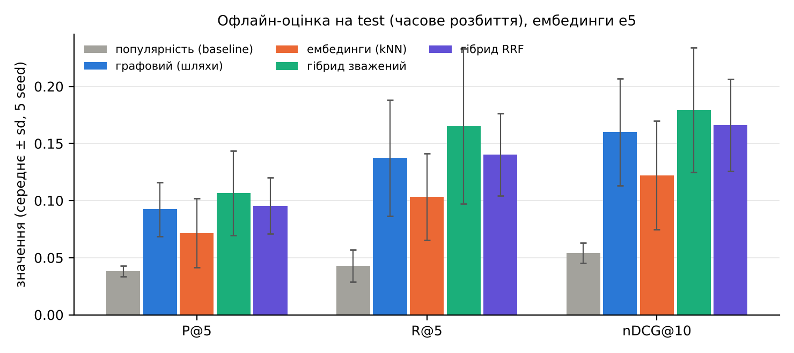
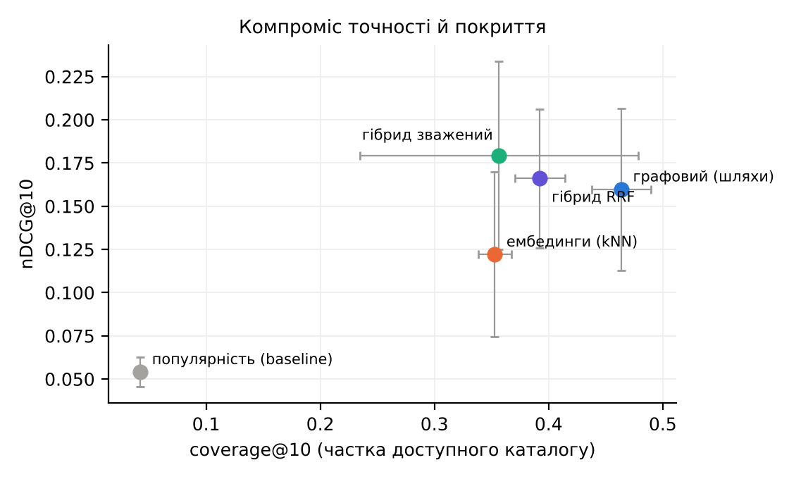
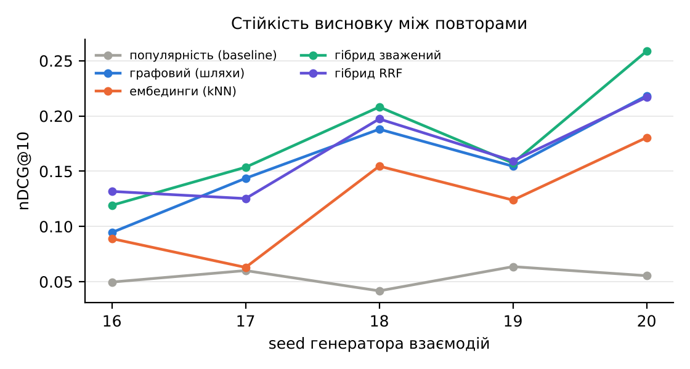

# Офлайн-оцінка рекомендацій (ЛР16, Р2)

Згенеровано `reco/make_docs.py` з `results/reco_eval_*.json`. Прогін: `python reco/eval.py --emb e5|lsa` (5 seed генератора 16–20).

## Протокол

- **Дані:** синтетичні журнали 60 користувачів (4 admin, 42 analyst, 14 guest) за 2026-08-01…11-07, події view/cite; генератор (`reco/data_gen.py`) знає лише теми документів, не граф і не ембединги.
- **Часове розбиття без витоку:** `train_fit < 2026-10-06 ≤ validation < 2026-10-20 ≤ test`. Ваги гібриду підбираються на validation моделлю, навченою лише на train_fit; фінальна модель навчається на всьому до 2026-10-20 і оцінюється на test.
- Популярність, профілі і згасання (період напіврозпаду 21 день) рахуються від моменту межі; документи, створені після межі, у train не потрапляють і для генератора недоступні до своєї дати.
- **Релевантні** = фрагменти, які користувач відкрив у test і не відкривав у train; рекомендуються лише не бачені й дозволені роллю (фільтри RBAC, перевіреність, чинність).
- **Метрики:** P@5, R@5, nDCG@10 (середнє за користувачами), coverage@10 (частка доступного каталогу в усіх топ-10), novelty@10 (−log₂ популярності, біти).
- **Невизначеність:** 95 % бутстреп-інтервали (1000 повторів за користувачами) для кожного seed і середнє ± sd за 5 seed.

## Результати: ембединги e5

| Конфігурація | P@5 | R@5 | nDCG@10 | coverage@10 | novelty@10, біт |
|---|---|---|---|---|---|
| популярність (baseline) | 0,038 ± 0,005 | 0,043 ± 0,014 | 0,054 ± 0,009 | 0,042 ± 0,005 | 6,728 ± 0,160 |
| графовий (шляхи) | 0,092 ± 0,024 | 0,137 ± 0,051 | 0,160 ± 0,047 | 0,464 ± 0,026 | 9,183 ± 0,059 |
| ембединги (kNN) | 0,072 ± 0,030 | 0,103 ± 0,038 | 0,122 ± 0,048 | 0,353 ± 0,014 | 9,683 ± 0,112 |
| гібрид зважений | 0,107 ± 0,037 | 0,165 ± 0,068 | 0,179 ± 0,055 | 0,357 ± 0,122 | 8,477 ± 0,780 |
| гібрид RRF | 0,096 ± 0,025 | 0,140 ± 0,036 | 0,166 ± 0,040 | 0,392 ± 0,022 | 8,587 ± 0,098 |

Seed 16: train 1803, test 385 взаємодій, користувачів у test 51; 95 % бутстреп-інтервали nDCG@10:

- популярність (baseline): 0,050 [0,021; 0,085]
- графовий (шляхи): 0,095 [0,057; 0,138]
- ембединги (kNN): 0,089 [0,042; 0,140]
- гібрид зважений: 0,119 [0,063; 0,180]
- гібрид RRF: 0,132 [0,076; 0,192]

Ваги зваженого гібриду (граф, ембединги, популярність), підібрані на validation: seed 16: (0.1, 0.6, 0.3); seed 17: (0.4, 0.5, 0.1); seed 18: (0.7, 0.3, -0.0); seed 19: (0.1, 0.5, 0.4); seed 20: (0.4, 0.4, 0.2)

## Результати: ембединги lsa

| Конфігурація | P@5 | R@5 | nDCG@10 | coverage@10 | novelty@10, біт |
|---|---|---|---|---|---|
| популярність (baseline) | 0,038 ± 0,005 | 0,043 ± 0,014 | 0,054 ± 0,009 | 0,042 ± 0,005 | 6,728 ± 0,160 |
| графовий (шляхи) | 0,092 ± 0,024 | 0,137 ± 0,051 | 0,160 ± 0,047 | 0,464 ± 0,026 | 9,183 ± 0,059 |
| ембединги (kNN) | 0,071 ± 0,023 | 0,103 ± 0,039 | 0,117 ± 0,041 | 0,381 ± 0,018 | 9,490 ± 0,036 |
| гібрид зважений | 0,100 ± 0,029 | 0,139 ± 0,048 | 0,171 ± 0,041 | 0,342 ± 0,086 | 8,152 ± 0,543 |
| гібрид RRF | 0,106 ± 0,019 | 0,143 ± 0,038 | 0,165 ± 0,046 | 0,389 ± 0,018 | 8,506 ± 0,116 |

Seed 16: train 1803, test 385 взаємодій, користувачів у test 51; 95 % бутстреп-інтервали nDCG@10:

- популярність (baseline): 0,050 [0,021; 0,085]
- графовий (шляхи): 0,095 [0,057; 0,138]
- ембединги (kNN): 0,084 [0,040; 0,141]
- гібрид зважений: 0,111 [0,066; 0,158]
- гібрид RRF: 0,129 [0,084; 0,180]

Ваги зваженого гібриду (граф, ембединги, популярність), підібрані на validation: seed 16: (0.3, 0.3, 0.4); seed 17: (0.5, 0.3, 0.2); seed 18: (0.3, 0.5, 0.2); seed 19: (0.1, 0.5, 0.4); seed 20: (0.1, 0.7, 0.2)

## Вибір кращої конфігурації

Обидва гібриди кращі за кожен окремий метод і приблизно втричі кращі за популярність. За середнім nDCG@10 зважений гібрид трохи вищий (0,179 проти 0,166).

Парний тест на тих самих 256 парах «користувач × seed» (`results/paired_e5.json`, бутстреп 2000) дає різницю 0,013, 95 % CI [-0,004; 0,030]. Інтервал містить нуль. За seed перемоги: {'hybrid_weighted': 3, 'hybrid_rrf': 2}.

**Обрано гібрид RRF**, бо:
- точність у межах похибки та сама, розкид між seed менший (sd 0,040 проти 0,055);
- немає навчуваних ваг: оптимальні ваги зваженого гібриду нестабільні між seed (див. вище), тож їх підбір на невеликій validation переналаштовується;
- покриття каталогу стабільніше (sd 0,022 проти 0,122);
- RRF не залежить від шкал балів, тому додавання нового джерела сигналу не потребує перенастроювання.

Зважений гібрид лишається варіантом, якщо з'являться реальні журнали й більша validation.

